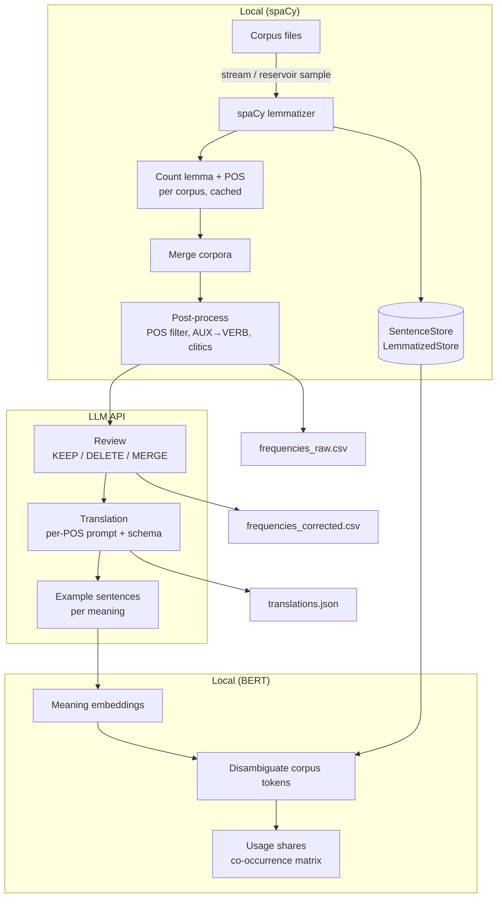

# Vocabulary pipeline

Builds a frequency-ordered vocabulary list for language learners from a large collection of
text. Words are ranked by how often they are actually used, so a learner can start with the
ones that matter most.

The list is organized by word, but **every meaning gets its own frequency**. *banco* is a bank,
a bench and a school of fish; the LLM estimates their shares of usage (70 %, 25 %, 5 %), so a
learner meets the bank early and the fish only when it becomes useful.

How it works, in four steps:

1. **Count.** spaCy reduces every word to its dictionary form (lemma) in context, and the forms are counted.
1. **Clean.** An LLM reviews the list and deletes or merges the errors the lemmatizer leaves behind.
1. **Translate.** The LLM translates each word, splits it into its meanings and estimates each
   meaning's share of usage.
1. **Disambiguate** *(experimental)*. BERT assigns every occurrence in the text to one of the
   meanings, to measure the shares in the corpus instead of estimating them
   (see [Status and limitations](#status-and-limitations)).

The approach is language-independent. I built and tested it for Spanish → German as the data
basis for a vocabulary-learning app.

## Pipeline

The pipeline streams the corpora, so memory use does not depend on corpus size. Every expensive
step is cached, so a rerun only processes what changed.



1. **Read** ([`src/corpus_readers/`](src/corpus_readers)): streams plain-text corpus files in
   batches. Two formats are supported: [OPUS](https://opus.nlpl.eu) (one sentence per line) and
   the [Leipzig Corpora Collection](https://wortschatz.uni-leipzig.de/en/download)
   (`id<TAB>sentence`). `max_sentences` draws a random sample with reservoir sampling, so only
   the sample is held in memory.
1. **Lemmatize** ([`src/lemmatizer.py`](src/lemmatizer.py)): spaCy with unused components
   disabled. Every token keeps spaCy's original POS tag; nothing is filtered at this stage.
   Original tokens and lemmas are written to two compressed stores
   ([`src/stores/`](src/stores)) for the disambiguation step.
1. **Count** ([`src/corpus_processor.py`](src/corpus_processor.py)): raw counts per corpus,
   cached by corpus file, modification time, sample size and spaCy model. Changing a filter
   never requires lemmatizing again.
1. **Post-process** ([`src/post_processor.py`](src/post_processor.py)): POS whitelist, POS
   mapping (e.g. `AUX → VERB`, so *ser* counts as one verb), removal of numbers written in digits,
   stripping of leftover clitic pronouns, and country names as the only allowed proper nouns.
1. **LLM review** ([`src/llm_corrector.py`](src/llm_corrector.py)): at this scale a lemmatizer
   leaves thousands of errors in the frequency range a learner cares about. The LLM decides for
   each lemma:

   - **KEEP** if the entry is a correct lemma.
   - **MERGE** inflected forms and wrong POS tags into the right lemma (*vas* → *ir*).
   - **DELETE** noise such as phantom infinitives (*dijistar* from *dijiste*) and loanwords.

   Lemmas are reviewed in frequency order, and the review stops once `target_output_size`
   clean lemmas exist. The result is a small `lemma → lemma` mapping that is applied while
   reading the stores, so the corpus is never rewritten. The rules are in
   [`prompts/correction/`](prompts/correction).
1. **LLM translation** ([`src/llm_translator.py`](src/llm_translator.py)): each part of speech
   has its own prompt and structured-output schema in
   [`prompts/translation_v2/`](prompts/translation_v2). A lemma is split into several meanings
   only for real ambiguity like *banco*, not for synonyms. Nouns get grammatical gender in
   both languages.
1. **Word sense disambiguation** *(experimental)*:
   - [`src/example_generator.py`](src/example_generator.py): the LLM writes ten example
     sentences for every meaning of an ambiguous lemma.
   - [`src/meaning_embedding_generator.py`](src/meaning_embedding_generator.py): BERT embeds
     the target word in each example; the mean of these vectors represents the meaning.
   - [`src/batch_disambiguator.py`](src/batch_disambiguator.py): every corpus occurrence is
     embedded the same way and assigned to the meaning with the highest cosine similarity.
     Sentences without an ambiguous lemma skip BERT, and batches are sized by token count.
   - [`src/share_updater.py`](src/share_updater.py) and
     [`src/cooccurrence_builder.py`](src/cooccurrence_builder.py): usage share per meaning
     and a sparse co-occurrence matrix of meanings.

The LLM steps share the infrastructure in [`src/llm_providers/`](src/llm_providers) and
[`src/lemma_cache.py`](src/lemma_cache.py):

- **Providers:** Gemini and OpenAI behind one interface.
- **Concurrency:** batches of lemmas, with many requests in flight at once (asyncio with a semaphore).
- **Rate limiting:** an optional requests-per-minute limit for API tiers with quotas.
- **Retries:** API errors and malformed answers are retried with exponential backoff.
- **Cost tracking:** prompt, output and thinking tokens are summed per step and logged.
- **Caching:** results are stored per lemma in SQLite under the model settings and a hash of
  the prompt. An interrupted run resumes where it stopped.

## Results

The Spanish → German run used four [OPUS](https://opus.nlpl.eu) corpora: TED talks, books,
Wikipedia and movie subtitles.

| Step | Model |
|---|---|
| Lemmatization | spaCy `es_core_news_lg` |
| Review, translation, example sentences | Gemini `gemini-3-flash-preview` |
| Word sense disambiguation | BETO, a Spanish BERT ([`dccuchile/bert-base-spanish-wwm-cased`](https://huggingface.co/dccuchile/bert-base-spanish-wwm-cased)) |

| | |
|---|---|
| Tokens lemmatized | 223 million |
| Lemmas with frequency ≥ 20 after filtering | 59,327 |
| Lemmas reviewed by the LLM | 34,326 (19,296 kept, 11,560 merged, 3,470 deleted) |
| Final frequency list | 20,115 lemmas |
| Lemmas with more than one meaning | 4,378 |

### Word sense disambiguation

On a hand-labelled test set of 204 sentences
([`test/data/disambiguation_test_data.json`](test/data/disambiguation_test_data.json)), the
disambiguation picks the correct meaning in **96.1 %** of the cases (196 of 204). In this
test every meaning is represented by one example sentence.

Averaging five example sentences per meaning fixed all 26 cases in a second test set, made
up of the errors above and errors found in pipeline runs. This result is not reliable on its
own: the cases were picked because they had failed, so they could only improve.

## Quickstart

```bash
conda env create -f environment.yml
conda activate LanguageApp-new
python -m spacy download es_core_news_lg
```

The full run needs the corpus files under `data/` (not in the repository) and a
`GOOGLE_API_KEY` in `.env` for the LLM steps. Corpora, filters, models and prompts are set in
[`config.yaml`](config.yaml).

```bash
python main.py
```

Two things run without corpora or an API key:

```bash
# unit tests of the post-processor
PYTHONPATH=.:test python test/test_post_processor.py

# word sense disambiguation on the test set (downloads BETO, about 440 MB, on first use)
PYTHONPATH=.:test python test/test_disambiguation.py
```

Each run writes to `<output.directory>/<timestamp>/`:

| File | Content |
|---|---|
| `frequencies_raw.csv` | the filtered frequency list before LLM review |
| `frequencies_corrected.csv` | the list after LLM review (if enabled) |
| `llm_corrections.csv`, `original_with_ids.csv` | every LLM decision and the entry it refers to, for auditing |
| `translations.json` | one entry per lemma with its meanings (if enabled) |
| `translations_disambiguated.json` | the same with usage shares measured in the corpus (if disambiguation is enabled) |
| `vocabulary_full/` | translations with embeddings and the co-occurrence matrix (if disambiguation is enabled) |
| `config.yaml`, `pipeline.log` | config snapshot and log, for reproducibility |

### Output format

Top of `frequencies_corrected.csv`. `pos` lists the spaCy tags that were merged into an entry:

```csv
lemma,frequency,pos,counter_key
de,9650398,ADP,de|ADP
ser,6316004,VERB/AUX,ser|VERB
no,5181827,ADV,no|ADV
a,4783161,ADP,a|ADP
en,4432163,ADP,en|ADP
```

One entry from `translations.json`. The frequency of a meaning is `frequency × estimated_share`:

```json
{
  "lemma": "banco", "pos": "NOUN", "frequency": 16204,
  "meanings": [
    {"definition_es": "entidad que realiza operaciones financieras con el dinero de sus clientes",
     "translations": [{"text": "Bank", "hints": ["Geldinstitut"], "gender_target": "f"}],
     "estimated_share": 0.7, "gender": "m"},
    {"definition_es": "mueble para sentarse, generalmente con capacidad para varias personas",
     "translations": [{"text": "Bank", "hints": ["Sitzbank"], "gender_target": "f"}],
     "estimated_share": 0.25, "gender": "m"},
    {"definition_es": "conjunto de muchos peces que nadan juntos",
     "translations": [{"text": "Schwarm", "hints": ["Fische"], "gender_target": "m"}],
     "estimated_share": 0.05, "gender": "m", "flags": ["rare"]}
  ]
}
```

## Status and limitations

**The main limitation is evaluation.** Most of the output comes from an LLM: which lemmas are
kept, how they are translated, how they are split into meanings. There is no reference list to
compare 20,000 entries against, and the answers can differ between runs. The tests in
[`test/`](test) are therefore evaluation scripts, not unit tests: they call the real LLM APIs
on small hand-labelled samples and report accuracy. They show that each step works well on
these samples. They do not guarantee that the final list is free of errors.

- **Used:** frequency list, LLM review and translation (steps 1 to 6 above).
- **Experimental:** word sense disambiguation. It was run on the two small corpora (TED talks
  and books, 9M tokens). The run over Wikipedia and subtitles (214M tokens) was not completed,
  so usage shares and the co-occurrence matrix do not exist for the full data.
- **Evaluation of the disambiguation:** the test sentences are short and constructed, and 168
  of the 204 cases have only two candidate meanings. Accuracy on real corpus text has not been
  measured.
- **Unit tests:** only the post-processor has plain unit tests that run without an API.
- **Sampling:** `max_sentences` is not seeded, although the count cache treats a sample as
  reproducible.
- **Language:** built and tested for Spanish → German only. Some Spanish specifics, such as
  the clitic pronouns, are hard-coded.

## Project structure

```
main.py                 pipeline entry point, one function per stage
config.yaml             corpora, filters, models, prompts
src/
├── corpus_readers/     streaming readers + reservoir sampling
├── lemmatizer.py       spaCy wrapper
├── frequency_counter.py  counts keyed by "lemma|POS"
├── corpus_processor.py   per-corpus processing with cache
├── post_processor.py   filtering and normalization
├── stores/             sentence, lemma and disambiguation stores (gzip JSONL, index-aligned)
├── llm_providers/      Gemini and OpenAI, rate limiter, retries, token usage
├── lemma_cache.py      SQLite cache of per-lemma LLM results
├── llm_corrector.py    KEEP / DELETE / MERGE review
├── llm_translator.py   per-POS translation with structured output
├── example_generator.py            example sentences per meaning
├── meaning_embedding_generator.py  BERT embedding per meaning
├── batch_disambiguator.py          corpus-wide word sense disambiguation
├── share_updater.py    usage share per meaning
├── cooccurrence_builder.py         co-occurrence matrix of meanings
└── vocab.py            data classes for lemmas, meanings and matrix entries
prompts/                correction, translation (per POS) and example prompts
test/                   evaluation scripts, test data, alternative disambiguators
experiments/            early prototypes (WordNet, word2vec, clustering); not part of the pipeline
CLAUDE.md               instructions for the AI coding assistant used during development
```
